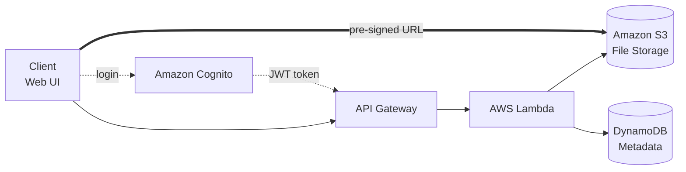

# Serverless File Storage System

A scalable, secure and cost-efficient cloud file storage system with **no servers to manage**. Users sign up, log in, and upload, download, list and delete their own files.

Built on AWS serverless services: **S3, Lambda, API Gateway, DynamoDB and Cognito**, deployed with **AWS SAM** and **GitHub Actions**.

- Presentation: [docs/Serverless_File_Storage_System.pptx](docs/Serverless_File_Storage_System.pptx)
- Detailed documentation: [docs/PROJECT_DETAILS.md](docs/PROJECT_DETAILS.md)

---

## Problem Statement

- Traditional file storage needs dedicated servers: setup, patching, scaling and monitoring.
- Fixed capacity means paying for idle resources or running out of space at peak load.
- Self-managed servers are a single point of failure and a security burden.
- Small teams and students need a simple, pay-per-use storage solution.

## Objectives

- Build file upload, download, list and delete with no server management.
- Authenticate users and keep each user's files private.
- Scale automatically and pay only for what is used.
- Automate deployment with Infrastructure as Code and GitHub CI/CD.

## Architecture



Files are uploaded and downloaded **directly to/from S3** using short-lived pre-signed URLs, so Lambda never handles file contents.

## Tech Stack

| Layer | Technology |
|---|---|
| Storage | Amazon S3 |
| Compute | AWS Lambda (Python 3.12) |
| API | Amazon API Gateway (REST) |
| Database | Amazon DynamoDB (file metadata) |
| Authentication | Amazon Cognito |
| Frontend | HTML, CSS, JavaScript |
| IaC | AWS SAM (CloudFormation) |
| CI/CD | GitHub Actions |
| Tests | pytest + moto |

## Features

- Sign up, email verification and login (Cognito)
- Upload via pre-signed S3 URLs (allowed: PNG, JPG, PDF, TXT, max 50 MB)
- List, download and delete personal files
- File metadata (name, size, type, date) in DynamoDB
- S3 versioning, encryption and lifecycle rules

## Project Structure

```
serverless-file-storage/
├── backend/
│   ├── lambdas/
│   │   ├── common.py        # shared helpers
│   │   ├── upload.py        # POST   /upload-url
│   │   ├── list_files.py    # GET    /files
│   │   ├── download.py      # GET    /files/{file_id}
│   │   └── delete.py        # DELETE /files/{file_id}
│   └── tests/               # unit tests (pytest + moto)
├── frontend/
│   ├── index.html
│   ├── style.css
│   ├── app.js
│   └── config.js            # API URL + Cognito IDs (edit after deploy)
├── infra/
│   └── template.yaml        # S3, DynamoDB, Cognito, API Gateway, Lambdas
├── docs/                    # PPT + detailed documentation
├── .github/workflows/
│   └── deploy.yml           # test + deploy pipeline
├── .gitignore
├── LICENSE
└── README.md
```

## API Endpoints

All endpoints need the Cognito ID token in the `Authorization` header.

| Method | Endpoint | Description |
|---|---|---|
| POST | `/upload-url` | Body: `file_name`, `content_type`, `size`. Returns a pre-signed upload URL |
| GET | `/files` | List the logged-in user's files |
| GET | `/files/{file_id}` | Returns a pre-signed download URL |
| DELETE | `/files/{file_id}` | Delete a file |

## Getting Started

### Prerequisites

- AWS account and [AWS CLI](https://aws.amazon.com/cli/) configured (`aws configure`)
- [AWS SAM CLI](https://docs.aws.amazon.com/serverless-application-model/latest/developerguide/install-sam-cli.html)
- Python 3.12

### 1. Run the tests

```bash
pip install -r backend/tests/requirements.txt
pytest backend/tests -v
```

### 2. Deploy the backend

```bash
sam build --template-file infra/template.yaml
sam deploy --guided --stack-name serverless-file-storage --capabilities CAPABILITY_IAM
```

When it finishes, note the **Outputs**: `ApiUrl`, `UserPoolClientId` and `Region`.

### 3. Configure the frontend

Edit `frontend/config.js`:

```js
window.APP_CONFIG = {
  API_URL: "<ApiUrl output>",
  COGNITO_REGION: "<Region output>",
  COGNITO_CLIENT_ID: "<UserPoolClientId output>",
};
```

### 4. Run the frontend

```bash
cd frontend
python -m http.server 8000
```

Open http://localhost:8000, sign up, verify your email and start uploading.

### 5. Clean up (to avoid charges)

Empty the S3 bucket first, then:

```bash
sam delete --stack-name serverless-file-storage
```

## CI/CD with GitHub Actions

The workflow in `.github/workflows/deploy.yml`:

1. Runs the unit tests on every push and pull request.
2. Deploys the stack with SAM when code is pushed to `main` and tests pass.

Add these in your repo under **Settings → Secrets and variables → Actions**:

| Secret | Value |
|---|---|
| `AWS_ACCESS_KEY_ID` | Access key of a deploy-only IAM user |
| `AWS_SECRET_ACCESS_KEY` | Matching secret key |

Also set `AWS_REGION` at the top of the workflow file. For better security, use GitHub OIDC with an IAM role instead of long-lived keys.

## Security

- Encryption at rest (SSE-S3) and in transit (HTTPS)
- S3 public access fully blocked
- Cognito JWT authorizer on every endpoint
- User ID comes from the verified token, never from the request, so users cannot access each other's files
- Least-privilege IAM policies per Lambda function
- Pre-signed URLs expire after 5 minutes
- File type, size and name validation

## Known Limitations

- Before production, restrict CORS (`AllowedOrigins`) to your real frontend domain.
- Metadata is saved when the upload URL is issued, so an abandoned upload can leave an entry with no file.
- Files above 5 GB would need S3 multipart upload.

## Future Scope

- File sharing with expiring links
- Virus scanning and thumbnails via S3 event triggers
- Search over file metadata
- Multi-region replication
- CloudWatch usage dashboard

## Author

**Your Name**: [@your-username](https://github.com/your-username)

## License

MIT, see [LICENSE](LICENSE).
